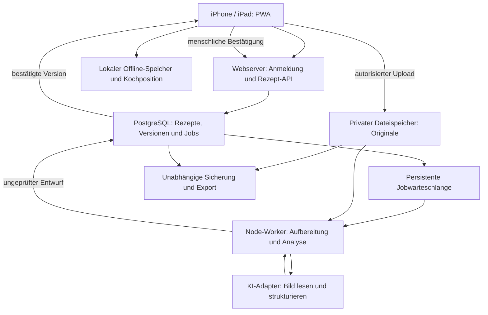

# Technischer Bauplan

> **Umsetzungsstand 27.10.2026:** Dieses Dokument beschreibt den vollständigen Bauvertrag. Den tatsächlich implementierten lokalen Stand, Grenzen und Migration dokumentieren [README](../README.md), [Architektur-Ist](ARCHITEKTUR-IST.md) und [Prüfbericht](PRUEFBERICHT-2026-10-27.md). Zielvorgaben gelten dadurch nicht als abgenommen.

**Version 1.1 · 26. Oktober 2026 · Spezifikation, noch keine Implementierung**

## 1. Architekturentscheidung

Empfehlung: **Next.js mit React und TypeScript als PWA**, **Supabase für Anmeldung, PostgreSQL und private Originaldateien**, **ein eigener Node.js-Worker für lang laufende Verarbeitung** sowie **eine austauschbare KI-Anbindung**. Zod beziehungsweise ein gleichwertiges gemeinsames Schema validiert die Daten an allen Übergängen.

Die Gründe: eine gemeinsame Oberfläche für Telefon und Tablet, übliche Webtechnologien, Datenbank und Dateien mit klaren Zugriffsregeln, ein Kochmodus ohne Modellabhängigkeit. Ein eigenständiger Worker verhindert, dass die Verarbeitung mit dem Schließen eines Browserfensters oder dem Ende einer Webanfrage abbricht.

Next.js dokumentiert die Bausteine für PWAs. Offline-Verhalten muss zusätzlich bewusst implementiert werden; ein Manifest allein genügt dafür nicht. [Next.js: PWA-Leitfaden](https://nextjs.org/docs/app/guides/progressive-web-apps).

Referenzaufbau für den Betrieb: ein verwalteter Node-Webdienst und ein getrennt startbarer Node-Worker, möglichst in einer passenden europäischen Region; Supabase-Projekt ebenfalls mit bewusst gewählter Region. Der konkrete Hoster und Tarif sind beim Einrichten anhand Laufzeit-, Speicher- und Budgetanforderungen festzulegen. Ein Anbieterwechsel darf weder Rezeptdaten noch Exportformat ändern. Die gesamte Verarbeitung wird dadurch nicht automatisch auf Europa beschränkt; die KI-Anbindung ist separat zu bewerten.

## 2. Komponenten und Datenfluss



Kein Modellschlüssel im Browser. Kein KI-Aufruf bei „Weiter“. Keine öffentlich erreichbaren Originaldateien. Der Browser darf nur mit dem eigenen angemeldeten Zugriff oder eng begrenzten Uploadberechtigungen Dateien übertragen.

## 3. Vorgesehene Projektstruktur

Erst beim Baubeginn anlegen; derzeit stehen hier nur Dokumente.

```text
apps/web/                 Oberfläche, PWA, serverseitige API
apps/worker/              Datei-Aufbereitung, Analyse, Export, Sicherungen
packages/domain/         Rezeptvertrag, Validierung, Zustandsübergänge
packages/ai/             Anbieteradapter, versionierte Prompts
packages/ui/             große wiederverwendbare Bedienelemente
supabase/migrations/     Datenbank, RLS, Jobs und Speicherregeln
tests/fixtures/public/   ausschließlich künstliche Testrezepte
tests/integration/       Zugriff, Versionen, Jobs, Export/Wiederimport
tests/e2e/               Import, Prüfung und Kochen
docs/                    dieser Bauplan, Betriebsanleitung und Entscheidungen
```

Ein Workspace, ein Lockfile, festgehaltene Node-Version. Konkrete Bibliotheksversionen beim Scaffold aus den dann aktuellen stabilen Veröffentlichungen wählen und sperren. Keine umfassende Anbieterabstraktion bauen: schmale Schnittstellen für Dateispeicher, Analyse und Sicherung genügen.

## 4. Fachliches Datenmodell

Alle nutzerbezogenen Tabellen tragen `owner_id`; der Server leitet ihn aus der Anmeldung ab. IDs sind stabile UUIDs. Beziehungen über mehrere Tabellen müssen denselben Eigentümer erzwingen. Änderungen an bestätigtem Inhalt erzeugen neue Versionen, kein stilles Überschreiben.

| Entität | Wesentliche Inhalte |
| --- | --- |
| `Recipe` | ID, Eigentümer, aktuelle bestätigte Versions-ID oder null, Archivstatus, Erstellzeit |
| `RecipeVersion` | ID, Rezept-ID, Elternversion, Schemaversion, Status, Titel, Portionen, vollständiger Inhalt, Ersteller, Bestätigung durch/um |
| `SourceAsset` | Original-ID, privater Speicherpfad, erkannter MIME-Typ, Bytes, SHA-256, ursprünglicher Dateiname, Erstellzeit |
| `SourcePage` | Original-ID, Seitennummer, Reihenfolge im Import, Vorschaudatei; Rotation/Zuschnitt als separate Transformation |
| `SourceSelection` | zum Rezept gehörige Seiten/Ausschnitte; keine stillschweigende Zuordnung ganzer Sammel-PDFs |
| `TranscriptionBlock` | Seitennummer, Lese-Reihenfolge, erkannter Rohtext, optionale Region im Original, Bearbeitungsstatus |
| `Ingredient` | stabile ID, Gruppen-ID, Mengenwortlaut, Einheitenwortlaut, Zutat, Zusatz, Feldherkunft |
| `Step` | stabile ID, Reihenfolge, Titel, vollständige Anweisung, Quellbezüge, belegbare Zutatenbezüge, Bedingungen und optionale Zeitangaben |
| `EquipmentItem` | Bezeichnung, Herkunft `source` oder `suggestion`, Quellschritte, optionale Nutzerbestätigung |
| `ReviewIssue` | betroffener Feldpfad/Block, Art, blockierend ja/nein, mögliche Lesarten, Entscheidung und Bearbeiter |
| `AnalysisRun` | gewählte Quellen, Prompt-/Schema-/Modellversion, Input-Hash, Ergebnisstatus, Kosten-/Nutzungsdaten ohne Rezeptinhalt im Log |
| `ImportJob` | Job-ID, Zustand, Versuch, Lease/Heartbeat, Fehlercode, nächste Ausführung, Abbruchmarkierung |
| `CollectionMetadata` | Kategorie, Favorit und eigene Notizen; getrennt von Anweisungen; Tagzuordnungen mit Herkunft/Override separat |
| `CookSession` | lokal: Rezeptversions-ID, optional Chargen-/Plan-ID und Portionsvariante, Schritt-ID, abgehakte Zutaten/Utensilien, Timer-Endzeitpunkte |

Der verbindliche Modellzusatz für Suche, Tags, Nährwertzuordnung, Menüplanrevisionen, Kochchargen und Einkaufsbeiträge steht in [PLANUNG-UND-NAEHRWERTE.md](PLANUNG-UND-NAEHRWERTE.md). Diese Daten gehören zum gleichen privaten Bereich und zum Export/Sicherungsumfang.

`RecipeVersion` kann den vollständigen fachlichen Inhalt in validiertem JSONB enthalten. Suchfelder und Versionsbeziehungen werden zusätzlich relational erschlossen. Damit bleibt eine Kochversion atomar und exportierbar. Die Tabelle oben beschreibt fachliche Entitäten; nicht jede muss eine eigene SQL-Tabelle werden.

### Herkunft auf Feldebene

Ein gemeinsamer Feldtyp enthält `value`, `rawText`, `origin`, `sourceRefs`, `reviewStatus` und optional die Entscheidung des Nutzers. `value` ist bei fehlender/unleserlicher Angabe `null`, niemals eine plausible Ersatzangabe. `sourceRefs` verweisen auf eigene Quellblöcke mit Seite und optionaler Region.

`origin`: `source` (aus Original gelesen), `user_addition` (bewusste Ergänzung), `derived` (unveränderte Information anders dargestellt), `estimate` (Planungsschätzung), `missing` (im Original nicht vorhanden). Der Prüfstatus ist davon unabhängig: Eine Bestätigung macht eine Schätzung nicht zum Original.

Mengen werden zuerst als Text gespeichert, beispielsweise „1½“, „1–2“, „etwas“ oder „1/8 l“. Optionale numerische Werte sind abgeleitete Zusatzfelder mit Parserstatus. Keine Gleitkomma- oder Einheitenumrechnung darf den Originalwortlaut ersetzen. `null` bedeutet unbekannt, nicht null Gramm.

Quellkoordinaten sind eine Navigationshilfe, kein Wahrheitsbeweis. Wenn sie unzuverlässig sind, die ganze Seite zeigen. Die App muss jeden Quellverweis auf Existenz und Zugehörigkeit prüfen. Die inhaltliche Übereinstimmung mit der Handschrift bleibt Gegenstand der Prüfung.

## 5. Zustände und Versionen

Dateiverarbeitung:

`uploading → uploaded → queued → preprocessing → extracting → validating → needs_review`

Zusätzliche Zustände: `failed`, `cancelled`. Ein fehlgeschlagener Import hat keinen heimlich freigegebenen Teilinhalt. Bereits gesicherte Originale bleiben für einen erneuten Versuch verfügbar. Jeder Übergang wird serverseitig geprüft.

Rezeptversion:

`draft → needs_review → confirmed`

Bestätigte Versionen sind unveränderlich. Eine Korrektur startet einen neuen Entwurf; die alte Version bleibt die aktuelle Kochfassung, bis die neue bestätigt ist. Offene Zweifel an der bereits bestätigten Fassung können diese ausdrücklich für neue Kochdurchgänge sperren. „Archiviert“ ist ein Rezeptstatus und keine Qualitätsbestätigung.

Freigabe durch eine atomare Serveroperation: gültige Anmeldung, erwartete Basisversion, vollständige Quelldeckung, keine offenen blockierenden Issues, ausdrückliche Nutzerbestätigung. Fehler erzeugen 409/422 statt eines teilweisen Zustandswechsels. Nutzerbestätigung behauptet keine mathematisch garantierte Richtigkeit.

## 6. Upload und Verarbeitung

Planwerte für die erste Version: maximal 25 MB pro Datei, maximal 10 ausgewählte Seiten pro Rezeptimport, insgesamt maximal 60 MB pro Import. Das sind Produktgrenzen, keine behaupteten Anbieterlimits. Vor Umsetzung auf realen Geräten und dem gewählten Hosting verifizieren; Ablehnung erfolgt vor kostenpflichtiger Analyse.

- Akzeptieren: JPEG, PNG, WebP, PDF; HEIC/HEIF aus iPhones über einen ausdrücklich getesteten Konvertierungsweg.
- Server prüft Dateisignatur, dekodierte Dimensionen, Seitenzahl und tatsächliche Größe. Dateiendung und Browser-MIME allein genügen nicht.
- Original unverändert im privaten Speicher; Arbeitsbilder separat, korrekt gedreht und mit zugehöriger Transformationsbeschreibung. EXIF-Ortsdaten nicht an die KI übertragen.
- Für Bilder Grenzen gegen extrem große dekodierte Flächen; PDFs in einem begrenzten Worker-Prozess rendern, eingebettete aktive Inhalte nicht ausführen. Passwortgeschützte oder beschädigte PDFs mit verständlicher Meldung zurückweisen.
- PDF-Text und gerenderte Seite können verglichen werden; eine vorhandene Textebene beweist keine richtige Reihenfolge und keine Vollständigkeit.
- HEIC-Kompatibilität inklusive Container, Farbraum und Orientierung am echten Gerät prüfen. Bei fehlender Unterstützung den Import klar ablehnen und JPEG/PDF als Alternative nennen; die App nicht als fertig abnehmen, solange normale iPhone-Aufnahmen am geplanten Pfad scheitern.
- Bestehende Originale mittels Hash erkennen, aber Duplikate nur vorschlagen; gleiche Vorlage mit anderer Auswahl kann ein eigener Import sein.

## 7. Persistente Jobs und KI

Eine PostgreSQL-Warteschlange über `pgmq` ist der Referenzweg. Sie benötigt einen tatsächlich laufenden Verbraucher; die Warteschlange selbst führt keine KI aus. Sichtbarkeitsfristen und erneute Zustellung verlangen idempotente Verarbeitung. [Supabase: pgmq](https://supabase.com/docs/guides/queues/pgmq).

Der Worker reserviert Jobs, verlängert bei Bedarf die Lease, speichert Zwischenschritte und bestätigt die Queue-Nachricht erst nach persistiertem Ergebnis. Eindeutiger Schlüssel über Eigentümer, Quellen-Hash, Auswahl, Prompt-/Schemaversion und bewusste Analyse-Generation. Ein erneuter Klick oder ein Worker-Neustart erzeugt keinen zweiten veröffentlichten Entwurf. Doppelte KI-Abrechnung bei unklarem Provider-Timeout lässt sich ohne passende Anbieterunterstützung nicht vollkommen ausschließen; Wiederholungen sind begrenzt.

Referenz-Retry: höchstens drei Versuche bei vorübergehenden Fehlern mit wachsendem Abstand; keine endlose Wiederholung bei ungültiger Datei, verweigertem Modelloutput oder Budgetgrenze. Danach verständlicher Fehlerzustand mit erneutem, bewusstem Start. Abbruch verhindert spätere Ergebnisveröffentlichung; eine bereits laufende Anbieteranfrage kann trotzdem Kosten verursachen.

KI-Adapter: serverseitige Responses-API mit Bildfähigkeit und strukturiertem Schema als erste Integrationsoption. Modell-ID wird konfiguriert und zusammen mit dem Ergebnis gespeichert. Kein Modellname wird hier als dauerhafter Qualitätsstandard festgeschrieben. Sol wählt anhand eines freigegebenen Rezept-Testbestands, Erkennungsfehlern, Laufzeit und Kosten. [OpenAI: Bildanalyse](https://developers.openai.com/api/docs/guides/images-vision).

Zwei fachliche Phasen: originalnahe Transkription mit Quellblöcken; anschließend Strukturierung nur aus dieser Transkription und den zugehörigen Seiten. Prüfungen erfolgen zusätzlich regelbasiert. Ein zweiter Modellaufruf kann Abweichungen finden, ist aber kein unabhängiger Beweis. Ausführliche Regeln: [REZEPTTREUE.md](REZEPTTREUE.md).

Analysekosten werden vor dem Start gegen ein App-Budget reserviert und nachher verrechnet. Parallel gestartete Importe dürfen das Budget nicht durch ein Rennen umgehen. Modelleingaben gelten als untrusted data: Rezepttext darf keine Systemvorgaben ändern, Tools aufrufen oder weitere URLs laden.

## 8. API-Verträge auf Aufgabenebene

| Operation | Verhalten |
| --- | --- |
| Import anlegen | angemeldeter Eigentümer, Grenzen prüfen, autorisierte Uploadziele ausstellen |
| Upload abschließen | vorhandene Originale/Hashes serverseitig verifizieren, Auswahl speichern, genau einen Job einreihen |
| Importstatus lesen | nur eigene Jobs, persistierten Status und verständlichen Fehler liefern |
| Entwurf lesen/ändern | eigene Quellbezüge, erwartete Revisionsnummer; konkurrierende Änderungen melden |
| Version bestätigen | vollständige serverseitige Freigabeprüfung, unveränderliche Version veröffentlichen |
| Kochversion laden | nur bestätigte, zugängliche Version; Originalstellen zeitlich begrenzt verfügbar machen |
| Offlinepaket laden | konsistenter Versionssnapshot, Inhalte und lokale Originalvorschau inklusive Prüfsummen |
| Export anlegen/holen | eigener Snapshot, asynchron, nur autorisierter Download |
| Export importieren | Paket validieren, Vorschau und Konfliktprüfung, Original-Hashes verifizieren |
| Rezept löschen | Papierkorb und Frist; endgültiges Löschen getrennt bestätigen; Caches mitbereinigen |
| Sammlung durchsuchen | private Volltext-/Zutaten-/Tag-Suche mit Filtern; Offlinebestand ausdrücklich begrenzen |
| Tags/Nährwerte ableiten | bestätigte Rezeptversion, versionierter Klassifikations-/Lebensmittelkatalog, Nutzerkorrekturen erhalten |
| Menüplan vorschlagen | eigene erlaubte Rezeptversionen, Präferenzen und Fixierungen validieren; bestehende Pläne nicht überschreiben |
| Menüplan übernehmen/ändern | manuelle und automatische Auswahl gleich behandeln, Planrevision und Einkaufsberechnung konsistent veröffentlichen |
| Einkauf abhaken/ergänzen | stabile Aktionen und Mengen; gleichzeitige Änderungen/Offline-Abgleich ohne doppelten Kaufbeitrag |

Mutierende Aufrufe erhalten CSRF-/Origin-Schutz entsprechend der Authentifizierung, serverseitige Eingabeschemata und Ratenlimits. Fremde IDs werden abgewiesen, bevor interne Verarbeitung oder Dateilinks erzeugt werden.

## 9. Anmeldung und Privatsphäre

MVP: ein privates Eigentümerkonto, Registrierung durch Einladung/Allowlist. Anmeldung mit E-Mail-Einmalcode ist eine sinnvolle Voreinstellung, weil sie Safari und Home-App nicht versehentlich über einen Linkwechsel trennt. Sitzung und Wiederanmeldung auf echten Geräten testen; keine Umgehung durch ein gemeinsames hartcodiertes Passwort.

RLS schützt Rezepttabellen und private Speicherobjekte. Ein Client bekommt ausschließlich das für ihn vorgesehene öffentliche Projektkennzeichen und Sitzungstoken. Privilegierte Service-Schlüssel bleiben beim Server/Worker. Supabase unterstützt Zugriffsregeln für Storage über RLS; Policies müssen für Lesen, Upload, Änderung und Löschen ausdrücklich getestet werden. [Supabase: Storage-Zugriff](https://supabase.com/docs/guides/storage/security/access-control).

Fotos werden zur Analyse an den gewählten KI-Anbieter übertragen; dies wird vor dem ersten Import verständlich erklärt. Anbieteraufbewahrung, Region und Optionen vor Inbetriebnahme prüfen. Die Architektur ist keine Ende-zu-Ende-Verschlüsselung gegenüber dem Analyseserver. Rezeptinhalte, Foto-URLs und Handschrift gehören nicht in gewöhnliche Diagnose-Logs oder Telemetrie.

Keine öffentliche Familienfreigabe im MVP. Spätere Mitgliedschaften brauchen eigene Berechtigungen und Zugriffstests; ein zusätzlicher Frontend-Button genügt nicht.

## 10. Offline und iOS

- Manifest, Icons, Service Worker und HTTPS. Lokale Entwicklung ist eine eigene Ausnahme; Installation auf echten Geräten über HTTPS testen.
- Service Worker speichert App-Shell; personalisierte API-Antworten nicht pauschal in einem gemeinsamen Cache ablegen.
- Ausgewählte bestätigte Rezepte mit Version, Zutaten, Schritten und Originalvorschauen in IndexedDB/Cache API laden. Accounts und Versionen strikt trennen.
- Erst nach vollständigem Schreiben und einer Lesekontrolle „Offline bereit“ anzeigen. Speicherfehler zurückmelden; unvollständige Pakete verwerfen.
- Offline-Kochposition und Timer bleiben gerätebezogen. Rezeptbearbeitung und neuer KI-Import benötigen im MVP Internet.
- Beim Abmelden lokale persönliche Pakete löschen; vor noch nicht gesicherten lokalen Daten warnen. Ein entzogenes Familienrecht kann später nicht rückwirkend eine Kopie auf einem offline gebliebenen Gerät vernichten; keine solche Garantie geben.
- Updates melden, aber nicht mitten im Kochen neu laden. Datenmigrationen vor Cachewechsel prüfen.
- Absolute Timer-Endzeit verwenden; Anzeigen aus aktueller Uhrzeit berechnen. Systemuhränderung erkennen, wenn möglich. Alarm bei geschlossenem/gesperrtem Gerät ist kein MVP-Abnahmeversprechen.
- Wake Lock nur bei sichtbarem Kochmodus, nach Rückkehr neu versuchen, Ablehnung normal behandeln.

Lokale Browserdaten sind löschbar. Offline-Speicherung ersetzt deshalb keine Sicherung. [WebKit: Speicher](https://webkit.org/blog/14403/updates-to-storage-policy/), [MDN: Wake Lock](https://developer.mozilla.org/en-US/docs/Web/API/Screen_Wake_Lock_API).

## 11. Sicherung, Export und Übergabe

**Drei getrennte Dinge:** Git sichert den Bauplan/Quellcode; die Datenbank speichert die Rezeptfassungen; der Dateispeicher enthält die Originale. Jede dieser Ebenen braucht den passenden Sicherungsweg.

Vorgabe für produktiven Betrieb: tägliche automatische Sicherung von Datenbank und Dateien in ein unabhängiges Ziel, 30 Tage tägliche und 12 monatliche Wiederherstellungspunkte als Startregel. Verschlüsselung der Sicherungen und gesicherter Schlüsselzugang für den Eigentümer. Zielwert: höchstens 24 Stunden Datenverlust und Wiederherstellung innerhalb eines Arbeitstages; diese Werte sind erst nach einem Test als erfüllt zu melden.

Eine Supabase-Datenbanksicherung enthält nicht die eigentlichen Storage-Dateien. Die Originale sind deshalb separat zu sichern. [Supabase: Datenbanksicherungen](https://supabase.com/docs/guides/platform/backups).

Portabler Export als ZIP oder bei großen Sammlungen mehrere Teile mit gemeinsamem Manifest:

```text
manifest.json               Export-/Schemaversion, Zeitpunkt, Datei-Hashes
recipes/<id>/recipe.json     strukturierte bestätigte Fassung
recipes/<id>/recipe.md       menschenlesbare Fassung
recipes/<id>/history/        frühere Fassungen und Herkunft
originals/<asset-id>.<ext>   unveränderte Originaldateien
README.txt                  Erklärung und Wiederimport-Anleitung
```

Export aus einem konsistenten Snapshot erstellen; Originale vor Paketfreigabe auf Existenz und Hash prüfen. Eine alleinige JSON-Ausgabe ist kein vollständiger Familienexport. Geprüfte und ungeprüfte Fassungen bleiben unterscheidbar. Exportdownload ist nur für den Eigentümer und mit kurzer Gültigkeit erlaubt.

Beim Wiederimport: Path-Traversal und übergroße entpackte Pakete abweisen, unterstützte Schemaversion prüfen, Referenzen/Hashes kontrollieren, vorhandene IDs konfliktfrei behandeln und nicht still überschreiben. Herkunft/alte IDs bleiben erhalten; Eigentümer und aktive Zugriffsrechte werden nicht aus einem fremden Paket übernommen. Originaldateien bytegleich wiederherstellen.

Vor ersten echten Archivdaten und danach regelmäßig einen kompletten Wiederherstellungstest durchführen. Das Betriebshandbuch enthält Kontoinhaber, Dienstliste, Schlüssel-Wiederherstellungsweg ohne Geheimnisse im Git, Export und Übergabe an Angehörige.

## 12. Verbindliche Grenzen der ersten Version

Kein App-Store-Paket nötig. Keine zuverlässigen Hintergrundalarme versprechen. Keine Offline-KI. Keine automatische Rezeptverbesserung. Kein umfassendes Familien-Rechtesystem vor dem Kernablauf. Keine Aussage „100 % korrekt erkannt“. Keine vollautomatische „für immer“-Archivgarantie.

Die erste abnehmbare App erfüllt den vollständigen Import-Prüfen-Kochen-Export-Wiederimport-Ablauf sowie Suche, Tags, Nährwerte, Rezeptvorschläge und beide Wege der Menüplanung mit automatischer Einkaufsliste. Eine schöne Oberfläche mit simulierten KI-Ergebnissen ist nur ein Prototyp.

## 13. Ergänzte Dienste

Volltextsuche und Tagfilter bleiben in PostgreSQL. Ein importierter, versionierter Lebensmittelkatalog mit schmalem Anbieteradapter liefert die Datengrundlage für Nährwerte; KI unterstützt die Zuordnung, nicht die Arithmetik. Klassifikation und Berechnung laufen nach Rezeptbestätigung als getrennte Jobs, deren Fehler den Kochmodus nicht blockieren.

Menüplan und Einkauf verwenden deterministische Domänenfunktionen für Portionen, Chargen, Aggregation, Revisionen und Einkaufsabgleich. Der KI-Adapter liefert lediglich validierbare Rezeptauswahlen und Vorschlagsbegründungen. Gespeicherte Entwürfe, bestätigte Rezepte und übernommene Pläne haben getrennte Zustände. Versionierung und Idempotenz gelten auch für Plan-/Einkaufsjobs. Vollständige Regeln und Datenobjekte: [Planung und Nährwerte](PLANUNG-UND-NAEHRWERTE.md).
